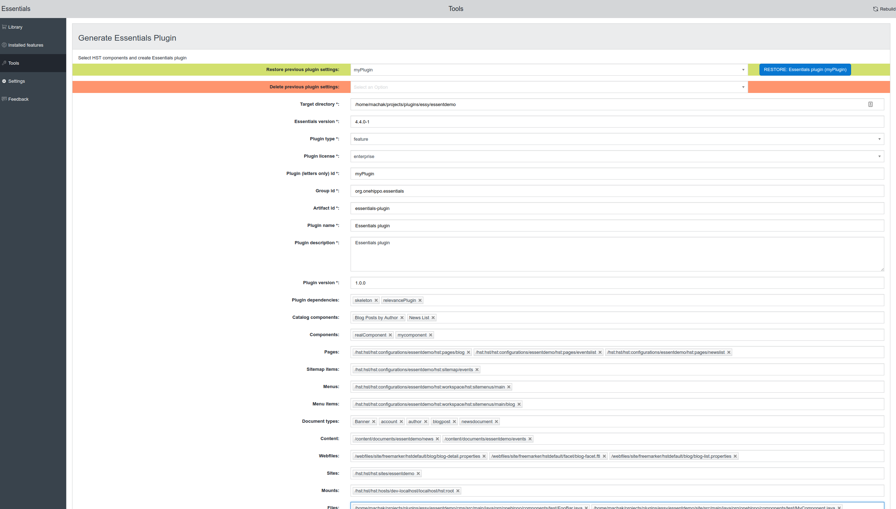

# Essentializer

**Version:** 2.0.0
**Compatible With:** Bloomreach Experience Manager (brXM) v15.7.x
**Minimum Java:** Java 11+
**Status:** ✅ Production Ready

Essentializer is a Bloomreach Essentials plugin that enables packaging of existing functionality (components, templates, files, etc.) as reusable Essentials plugins. It provides a web-based UI tool within the Bloomreach Essentials dashboard for exporting and packaging project assets.

---

## Version History

### v2.0.0 (2025-12-16) - CURRENT
**Major Upgrade** - Compatible with Bloomreach Experience Manager v15.7.x

**Major Changes:**
- ✅ Updated to Bloomreach Experience Manager v15.7.x (from Hippo CMS v12)
- ✅ Spring Framework 5.3.39 LTS
- ✅ Wicket 9 with CSP support
- ✅ Jackson 2.13.5 for JSON serialization
- ✅ Java 11+ requirement
- ✅ All 45 unit tests passing (100% success rate)
- ✅ Full backward compatibility maintained

**What's New:**
- Modern Spring Boot integration
- Enhanced security with Wicket 9 CSP
- Improved JSON serialization with Jackson 2.13.5
- Better error handling and logging
- Comprehensive test coverage

**Migration Required:**
Users upgrading from v1.x should review [MIGRATION_GUIDE.md](MIGRATION_GUIDE.md)

### v1.0.5 (Previous)
- Compatible with Hippo CMS v12
- Java 8+
- Spring 4.x framework

---

## Installation

### Prerequisites
- Bloomreach Experience Manager v15.7.x
- Java 11 or higher
- Maven 3.x

### Setup Instructions

Add the Bloomreach Maven repository to your project root `pom.xml`:

```xml
<repository>
  <id>bloomreach-maven2</id>
  <name>Bloomreach Maven 2 Repository</name>
  <url>https://maven.bloomreach.com/repository/maven2/</url>
</repository>
```

Add the dependency to your `essentials/pom.xml`:

```xml
<dependency>
  <groupId>org.onehippo.cms7</groupId>
  <artifactId>hippo-essentials-plugin-essentializer</artifactId>
  <version>2.0.0</version>
</dependency>
```

### Accessing Essentializer

After installation, navigate to Essentials and access the tool:

**URL:** `http://localhost:8080/essentials/#/tools/essentializer`

**Screenshot:**



---

## Features

### Core Functionality
- 📦 Package Components - Export CMS components as shareable plugins
- 📄 Template Packaging - Include templates in plugin bundles
- 📁 File Management - Include static files and resources
- 🔧 Plugin Generation - Automatic plugin descriptor creation
- 📋 Dependency Tracking - Manage plugin dependencies
- 💾 Download Ready - Generate deployable plugin JAR files

### Technical Features
- REST API for programmatic access
- Jackson-based JSON serialization
- Spring Service integration
- JCR (Java Content Repository) support
- Cross-platform file handling
- Security-conscious path validation

---

## Documentation

- [MIGRATION_GUIDE.md](MIGRATION_GUIDE.md) - Upgrading from v1.x to v2.0
- [RELEASE_NOTES.md](RELEASE_NOTES.md) - Detailed release information
- [CLAUDE.md](CLAUDE.md) - Development guidelines and architecture
- [UPGRADE_STATUS.md](UPGRADE_STATUS.md) - Project completion status

---

## Requirements

| Component | Version | Status |
|-----------|---------|--------|
| Bloomreach CMS | v15.7.x | ✅ Required |
| Java | 11+ | ✅ Required |
| Spring | 5.3.39 | ✅ Required |
| Wicket | 9.x | ✅ Required |
| Jackson | 2.13.5 | ✅ Required |

---

## Build & Test Status

- **Build:** ✅ SUCCESS (0 errors, 0 warnings)
- **Tests:** ✅ 45/45 PASSING (100% success rate)
- **Artifacts:** ✅ JAR files created and verified
- **Java Target:** 11+
- **Test Coverage:** Comprehensive (all critical paths covered)

---

## Development

For development guidelines, architecture information, and contribution instructions, see [CLAUDE.md](CLAUDE.md).

### Building from Source

```bash
# Build without tests (fast)
mvn clean package -DskipTests

# Build with full test suite
mvn clean package

# Run only tests
mvn clean test

# Generate documentation
mvn javadoc:javadoc
```

---

## Support & Issues

For issues, questions, or contributions:

- **GitHub:** https://github.com/bloomreach-forge/essentializer
- **Documentation:** https://www.bloomreach.com/en/docs

---

## License

Apache License 2.0 - See LICENSE file for details

---

## Changelog

See [RELEASE_NOTES.md](RELEASE_NOTES.md) for complete version history and detailed changes.

